# 🏛️ LITERA — Toko Buku & Alat Tulis (Ala Gramedia)
> **Mata Kuliah:** Web Programming 2 — Ujian Tengah Semester (UTS) Integrated Laravel Project  
> **Tema Sistem:** Sistem Inventori & Kasir Penjualan Toko Buku dan Alat Tulis Terintegrasi  
> **Tech Stack:** PHP 8.2+, Laravel 11 (MVC Architecture), MySQL 8.x / MariaDB, Eloquent ORM, Blade + Tailwind CSS  
> **Status Verifikasi:** 100% Memenuhi Seluruh Standar Penilaian (22 Automated Tests Passed, 113 Assertions)

---

## 📋 Daftar Isi
1. [Project Overview](#1-project-overview)
2. [Prasyarat Sistem (Requirements)](#2-prasyarat-sistem-requirements)
3. [Panduan Instalasi Langkah-demi-Langkah](#3-panduan-instalasi-langkah-demi-langkah)
4. [Konfigurasi Environment (.env)](#4-konfigurasi-environment-env)
5. [Migrasi Database & Seeding](#5-migrasi-database--seeding)
6. [Akun Demo & Hak Akses (Credentials)](#6-akun-demo--hak-akses-credentials)
7. [Fitur Utama & Aturan Bisnis (Business Rules)](#7-fitur-utama--aturan-bisnis-business-rules)
8. [Penanganan Masalah Umum (Troubleshooting)](#8-penanganan-masalah-umum-troubleshooting)
9. [Batasan Sistem (Known Limitations)](#9-batasan-sistem-known-limitations)
10. [Final ERD & Relasi Database](#10-final-erd--relasi-database)
11. [Relasi Eloquent ORM](#11-relasi-eloquent-orm)
12. [Bukti Pengujian Automated Test (PHPUnit)](#12-bukti-pengujian-automated-test-phpunit)
13. [Dokumentasi Visual (Screenshots)](#13-dokumentasi-visual-screenshots)
14. [Panduan Wawancara Code Ownership](#14-panduan-wawancara-code-ownership)

---

## 1. Project Overview

**LITERA** adalah aplikasi berbasis web untuk manajemen inventori dan kasir penjualan toko buku dan alat tulis (*terinspirasi dari alur bisnis Gramedia Store*). Sistem ini dibangun untuk mengatasi kendala operasional pencatatan manual:
- **Pembaruan Stok Otomatis:** Stok bertambah seketika saat kulakan (*Stock-In*) dan berkurang saat transaksi penjualan (*Stock-Out* / *Customer Checkout*).
- **Anti-Overselling & Race Condition:** Mencegah penjualan melebihi stok fisik dengan validasi server ganda dan penguncian baris database (*pessimistic locking via `Product::lockForUpdate()`*).
- **Integritas Transaksi Atomik:** Menggunakan `DB::transaction()` sehingga jika terjadi kegagalan pada satu item, seluruh transaksi dibatalkan (*atomic rollback*) tanpa meninggalkan data parsial.
- **Role-Based Access Control (RBAC):** Memisahkan otorisasi secara ketat antara **Admin**, **Staff**, dan **Customer** langsung di tingkat server/middleware.
- **Katalog E-Commerce Interaktif:** Menyediakan katalog belanja dengan filter kategori dinamis, pencarian SKU/nama, keranjang belanja (*Shopping Cart*), serta riwayat nota customer.
- **Dashboard Agregat:** Menampilkan omzet harian & bulanan, frekuensi transaksi, serta peringatan otomatis barang yang menipis (*Low-Stock Alert*).

---

## 2. Prasyarat Sistem (Requirements)

Sebelum menjalankan aplikasi, pastikan komputer/server Anda memenuhi spesifikasi berikut:
* **PHP:** Versi 8.2 atau lebih baru.
  * Ekstensi PHP yang wajib aktif: `pdo_mysql`, `mbstring`, `openssl`, `tokenizer`, `xml`, `ctype`, `json`, `fileinfo`, `curl`.
* **Database Server:** **MySQL 8.x** atau **MariaDB 10.4+** (tersedia melalui XAMPP, Laragon, Docker, dsb.).
* **Composer:** Versi 2.x atau lebih baru.
* **Node.js & NPM:** Node.js v18+ dan NPM v9+ (untuk kompilasi asset Vite/Tailwind CSS jika diperlukan).
* **Web Browser:** Google Chrome, Mozilla Firefox, Microsoft Edge, atau Safari modern.

---

## 3. Panduan Instalasi Langkah-demi-Langkah

Ikuti langkah-langkah instalasi berikut dari awal:

### Langkah 1: Clone atau Buka Folder Proyek
Buka terminal (Command Prompt / PowerShell / Git Bash), arahkan ke direktori proyek:
```bash
cd C:\coding\LITERA\LITERA
```

### Langkah 2: Install Dependensi PHP
Jalankan Composer untuk mengunduh vendor packages Laravel:
```bash
composer install
```

### Langkah 3: Install & Build Asset Frontend
```bash
npm install
npm run build
```

### Langkah 4: Pastikan Direktori Storage Tersedia
Pastikan subfolder storage Laravel telah dibuat (termasuk folder cache view):
```powershell
# Di Windows PowerShell:
$dirs = @(
    "storage\app\public",
    "storage\framework\cache\data",
    "storage\framework\sessions",
    "storage\framework\testing",
    "storage\framework\views",
    "storage\logs"
)
foreach ($d in $dirs) { if (-not (Test-Path $d)) { New-Item -ItemType Directory -Path $d -Force | Out-Null } }
```

### Langkah 5: Buat Symbolic Link Storage
Hubungkan direktori publik ke storage agar gambar produk baru dapat diakses:
```bash
php artisan storage:link
```

---

## 4. Konfigurasi Environment (.env)

1. Salin file template konfigurasi `.env.example` menjadi `.env` (jika belum ada):
   ```bash
   cp .env.example .env
   ```
2. Generate Application Key:
   ```bash
   php artisan key:generate
   ```
3. Buka file `.env` dan pastikan konfigurasi database sesuai dengan service MySQL lokal Anda:
   ```ini
   APP_NAME="LITERA Store"
   APP_ENV=local
   APP_KEY=base64:...
   APP_DEBUG=true
   APP_URL=http://localhost:8000

   DB_CONNECTION=mysql
   DB_HOST=127.0.0.1
   DB_PORT=3306
   DB_DATABASE=gramedia_store_db
   DB_USERNAME=root
   DB_PASSWORD=
   ```
   *(Pastikan service MySQL di XAMPP/Laragon sudah berstatus **Running**).*

---

## 5. Migrasi Database & Seeding

Jalankan perintah migrasi dan seeder untuk membuat tabel serta mengisi data awal toko buku:

```bash
php artisan migrate:fresh --seed
```

Perintah di atas akan secara otomatis mengeksekusi:
1. Pembuatan seluruh skema tabel inti (`users`, `categories`, `suppliers`, `products`, `purchases`, `purchase_items`, `sales`, `sale_items`).
2. Pembuatan 3 akun pengguna utama (**Admin**, **Staff**, **Customer**).
3. Pembuatan kategori toko (*Novel & Sastra*, *Buku Komputer*, *Self-Improvement*, *ATK*).
4. Pembuatan supplier mitra penerbit resmi.
5. Pembuatan data produk buku & ATK lengkap dengan cover resolusi tinggi.

### Menjalankan Server Lokal:
```bash
php artisan serve
```
Akses aplikasi melalui browser: **[http://localhost:8000](http://localhost:8000)** atau **[http://127.0.0.1:8000](http://127.0.0.1:8000)**.

---

## 6. Akun Demo & Hak Akses (Credentials)

Sistem telah menyediakan 3 akun pengujian dengan password default: `password`. Halaman `/login` juga dilengkapi tombol cepat 1-klik untuk kemudahan pengujian.

| Peran (Role) | Email Login | Password | Cakupan Hak Akses Utama |
| :--- | :--- | :--- | :--- |
| **Admin / Owner** | `admin@gramedia.test` | `password` | **Full Back-Office:** Dashboard finansial & omzet, Full CRUD Kategori, Supplier, Produk (Buku & ATK), Soft Delete produk, Input Kulakan, Input Kasir, **Otoritas Pembatalan Nota Transaksi**, serta Manajemen Pengguna (`/users`). |
| **Staff Toko** | `staff@gramedia.test` | `password` | **Back-Office Terbatas:** Dashboard operasional stok, Melihat Master Data, Input Barang Masuk dari Penerbit (Kulakan), Input Transaksi Kasir POS. *(Dilarang menghapus data master, membatalkan transaksi, atau mengelola user).* |
| **Customer** | `customer@gramedia.test` | `password` | **Etalase Publik:** Menjelajah katalog buku (`/catalog`), filter kategori & pencarian SKU, Keranjang Belanja (*Cart*), *Checkout* nota belanja mandiri, dan melihat riwayat nota belanja pribadi (`/my-orders`). *(Ditolak dari area back-office).* |

---

## 7. Fitur Utama & Aturan Bisnis (Business Rules)

### A. Autentikasi & Otorisasi Server-Side
- Menggunakan middleware kustom `App\Http\Middleware\RoleMiddleware` (`role:admin,staff` dan `role:admin`).
- Proteksi hak akses dijalankan di level controller & router (bukan sekadar menyembunyikan tombol UI).
- Setiap upaya akses ilegal akan dihentikan langsung dengan kode HTTP `403 Forbidden`.

### B. Alur Transaksi & Konsistensi Stok
1. **Stock-In / Kulakan dari Penerbit (`/purchases`):**
   - Staff memilih supplier, tanggal transaksi, serta memilih item barang multi-baris secara dinamis.
   - Stok inventori bertambah seketika secara otomatis begitu transaksi disimpan.
   - Harga beli terakhir produk otomatis diperbarui dari nota faktur kulakan.
2. **Stock-Out / Kasir & Belanja Customer (`/sales` & `/checkout`):**
   - Transaksi kasir maupun checkout customer memvalidasi ketersediaan stok fisik di server.
   - Stok terpotong otomatis seketika nota terbit.
3. **Pencegahan Overselling & Race Condition:**
   - Menggunakan `Product::lockForUpdate()` dalam blok `DB::transaction` untuk mengunci baris data stok selama kalkulasi berlangsung.
4. **Prinsip Atomisitas Transaksi (Rollback):**
   - Jika satu item buku dalam nota kekurangan stok, seluruh nota dibatalkan utuh (`DB::rollBack()`). Tidak akan ada data faktur atau stok yang tersimpan separuh.
5. **Perhitungan Harga Server-Side:**
   - Subtotal dan total dihitung 100% di server dari database resmi, mencegah manipulasi harga dari inspect element browser.
6. **Pembatalan Nota Transaksi (Cancel Transaction):**
   - Hanya dapat dilakukan oleh **Admin**.
   - Batal nota kulakan: stok barang ditarik kembali secara otomatis.
   - Batal nota penjualan: stok barang dipulihkan kembali ke etalase secara otomatis.
7. **Perlindungan Riwayat Transaksi (SoftDeletes):**
   - Produk yang sudah memiliki riwayat penjualan tidak boleh dihapus keras (*hard delete*). Digunakan `SoftDeletes` (`deleted_at`) agar laporan penjualan historis tetap konsisten.

### C. Search, Filter, Pagination, & Dashboard Agregat
- **Pencarian Cepat:** Mencari buku berdasarkan judul, pengarang, maupun kode SKU / ISBN.
- **Filter Fleksibel:** Filter kategori, status nota (`completed`/`cancelled`), rentang tanggal transaksi, serta status stok (`low` / `out`).
- **Pagination Bersih:** Menggunakan `->withQueryString()` agar filter pencarian tetap aktif saat berpindah halaman tabel.
- **Dashboard Agregat:**
  - Total produk, kategori, dan pemasok terdaftar.
  - Pendapatan & jumlah transaksi hari ini.
  - Pendapatan & jumlah transaksi bulan ini.
  - Tabel Peringatan Stok Rendah (*Low-Stock Alert*) di mana `stock <= minimum_stock`.

---

## 8. Penanganan Masalah Umum (Troubleshooting)

### 1. Error: `InvalidArgumentException: Please provide a valid cache path.`
* **Penyebab:** Folder cache Blade `storage/framework/views` belum ada di direktori lokal.
* **Solusi:** Jalankan script PowerShell di Langkah 4 instalasi atau buat manual folder `storage/framework/views`, lalu jalankan:
  ```bash
  php artisan optimize:clear
  ```

### 2. Gambar Produk Tidak Muncul di Katalog
* **Penyebab:** Database belum di-seed (`Product::count() == 0`) atau symbolic link storage belum dibuat.
* **Solusi:**
  ```bash
  php artisan storage:link
  php artisan db:seed
  ```

### 3. Error Koneksi Database `Access denied for user`
* **Solusi:** Periksa kembali file `.env` pada bagian `DB_USERNAME` dan `DB_PASSWORD`. Pastikan MySQL di XAMPP/Laragon menyala pada port 3306.

---

## 9. Batasan Sistem (Known Limitations)

Sesuai ruang lingkup tugas Ujian Tengah Semester (UTS):
1. **Payment Gateway Pihak Ketiga:** Tidak terhubung ke payment gateway eksternal (Midtrans/Xendit); transaksi kasir dan checkout diselesaikan secara langsung (*completed status*).
2. **Kalkulasi Kurir / Ekspedisi API:** Tidak menghitung ongkos kirim berbasis koordinat GPS atau API RajaOngkir.
3. **Multi-Cabang Kompleks:** Pengelolaan inventori difokuskan pada satu toko buku induk (*single centralized inventory*).

---

## 10. Final ERD & Relasi Database

### Mermaid Entity-Relationship Diagram

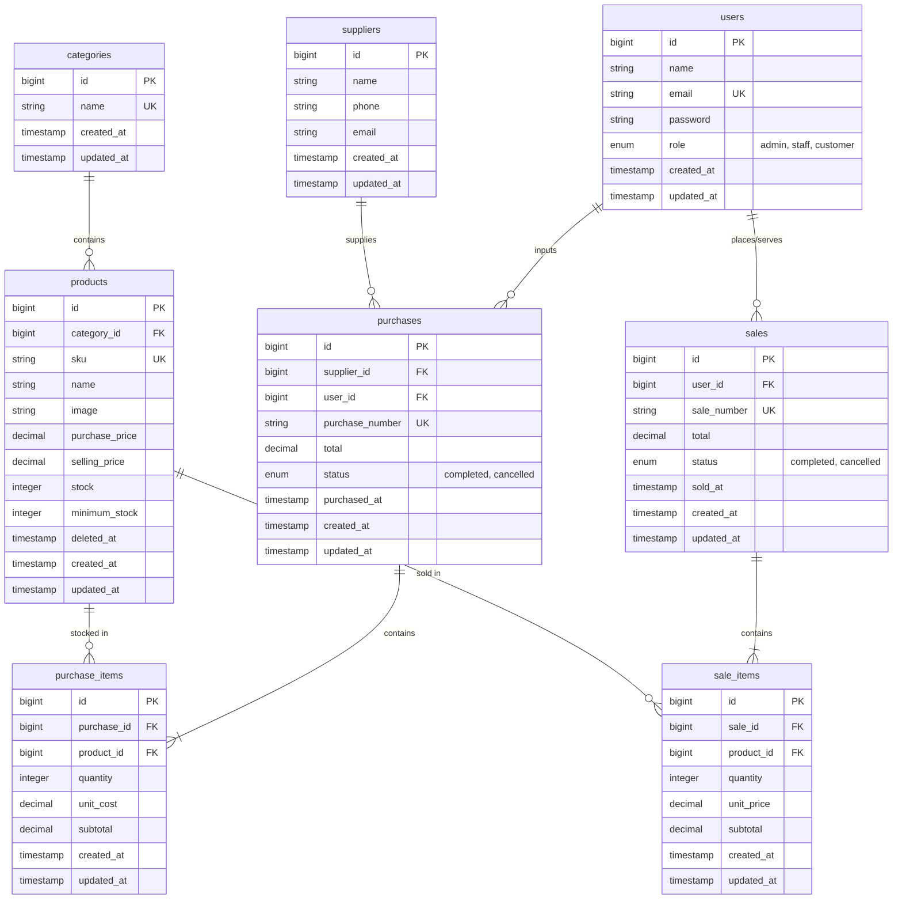

---

## 11. Relasi Eloquent ORM

Pemetaan relasi Eloquent Model diimplementasikan secara terstruktur:

| Model Sumber | Method Relasi | Jenis Relasi | Model Tujuan | Keterangan & Foreign Key |
| :--- | :--- | :--- | :--- | :--- |
| `Category` | `products()` | `hasMany` | `Product` | 1 Kategori memiliki banyak produk buku/ATK. |
| `Product` | `category()` | `belongsTo` | `Category` | FK: `category_id` &rarr; `categories.id`. |
| `Supplier` | `purchases()` | `hasMany` | `Purchase` | 1 Supplier/Penerbit memiliki banyak transaksi kulakan. |
| `Purchase` | `supplier()` | `belongsTo` | `Supplier` | FK: `supplier_id` &rarr; `suppliers.id`. |
| `Purchase` | `items()` / `purchaseItems()` | `hasMany` | `PurchaseItem` | 1 Nota pembelian memiliki banyak baris rincian item. |
| `PurchaseItem` | `purchase()` | `belongsTo` | `Purchase` | FK: `purchase_id` &rarr; `purchases.id` (*cascade delete*). |
| `PurchaseItem` | `product()` | `belongsTo` | `Product` | FK: `product_id` &rarr; `products.id` (`withTrashed()`). |
| `User` | `sales()` | `hasMany` | `Sale` | 1 User mencatat / memiliki banyak transaksi penjualan. |
| `User` | `purchases()` | `hasMany` | `Purchase` | 1 Petugas mencatat banyak transaksi pengadaan barang. |
| `Sale` | `user()` | `belongsTo` | `User` | FK: `user_id` &rarr; `users.id`. |
| `Sale` | `items()` / `saleItems()` | `hasMany` | `SaleItem` | 1 Nota penjualan memiliki banyak baris rincian item. |
| `SaleItem` | `sale()` | `belongsTo` | `Sale` | FK: `sale_id` &rarr; `sales.id` (*cascade delete*). |
| `SaleItem` | `product()` | `belongsTo` | `Product` | FK: `product_id` &rarr; `products.id` (`withTrashed()`). |

---

## 12. Bukti Pengujian Automated Test (PHPUnit)

Seluruh logika bisnis, proteksi role, keutuhan stok, dan ketersediaan rute telah diuji dengan automated testing:

```bash
php artisan test
```

### Hasil Eksekusi Uji Lengkap:
```text
   PASS  Tests\Unit\ExampleTest
  ✓ that true is true                                                    0.01s

   PASS  Tests\Feature\ExampleTest
  ✓ the application returns a successful response                        0.38s

   PASS  Tests\Feature\GramediaStoreTest
  ✓ seeder populates required data                                       0.04s
  ✓ login redirects based on role                                        0.05s
  ✓ customer registration                                                0.04s
  ✓ role protections for customer                                        0.05s
  ✓ role protections for staff                                           0.06s
  ✓ purchase stock in and cancel restore                                 0.04s
  ✓ sale stock out and cancel restore                                    0.04s
  ✓ sale transaction rollback when insufficient stock                    0.03s
  ✓ customer cart and checkout                                           0.04s
  ✓ customer cannot view other customer orders                           0.03s
  ✓ product soft delete                                                  0.03s
  ✓ auth guest cannot access dashboard and wrong password rejected       0.24s
  ✓ product validation duplicate sku and negative price rejected         0.04s
  ✓ sale transaction multi item atomicity rollback                       0.03s
  ✓ search and filter and pagination                                     0.04s

   PASS  Tests\Feature\SmokeTest
  ✓ guest routes accessible                                              0.05s
  ✓ customer routes accessible                                           0.04s
  ✓ staff routes accessible                                              0.06s
  ✓ admin routes accessible                                              0.05s
  ✓ edit and show pages                                                  0.05s

  Tests:    22 passed (113 assertions)
  Duration: 1.63s
```

---

## 13. Dokumentasi Visual (Screenshots)

Berikut tangkapan layar antarmuka sistem pada direktori `docs/screenshots`:

### 1. Diagram ERD Sistem (8 Tabel Berelasi)
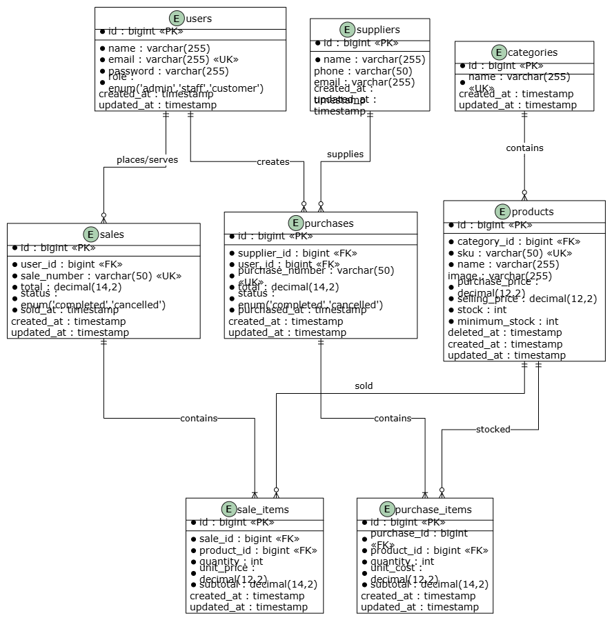

---

### 2. Autentikasi: Halaman Login (Akses 1-Klik Akun Demo)
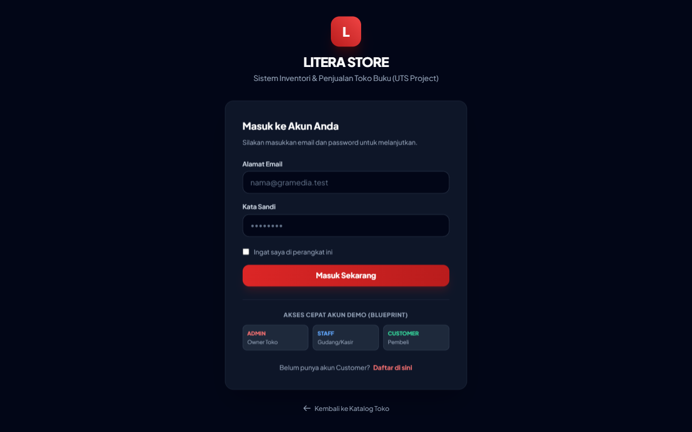

---

### 3. Etalase Publik: Katalog Belanja Customer (Mobile & Desktop)
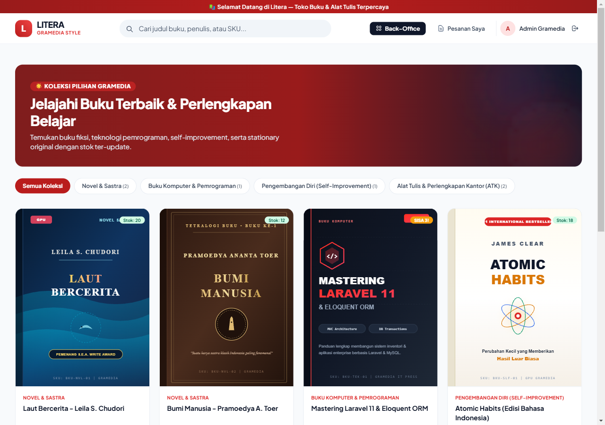

---

### 4. Back-Office: Dashboard Agregat Admin (Penjualan Hari Ini & Bulan Ini)
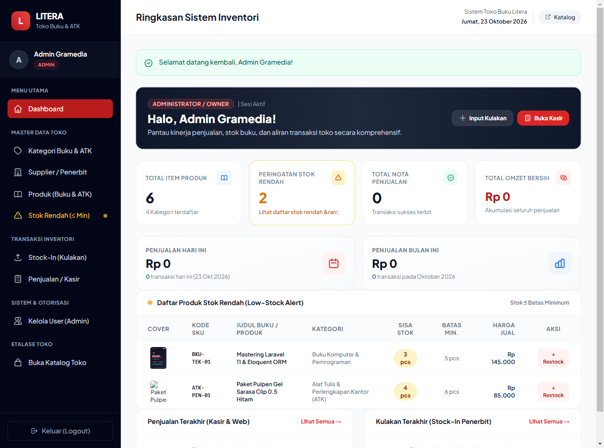

---

### 5. Master Data: Daftar Produk Buku & ATK (SKU, Harga, Stok)
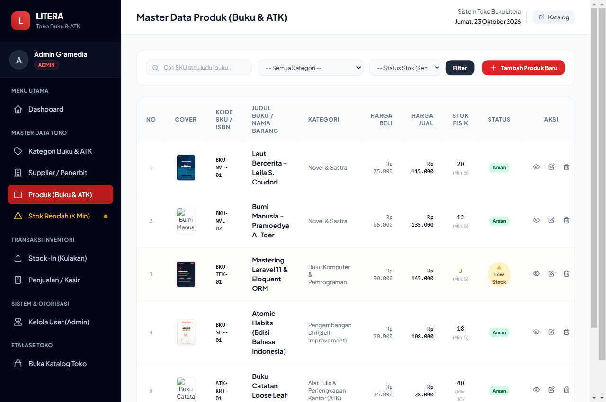

---

### 6. Peringatan Stok Rendah (Low-Stock Alert: Stok &le; Minimum)
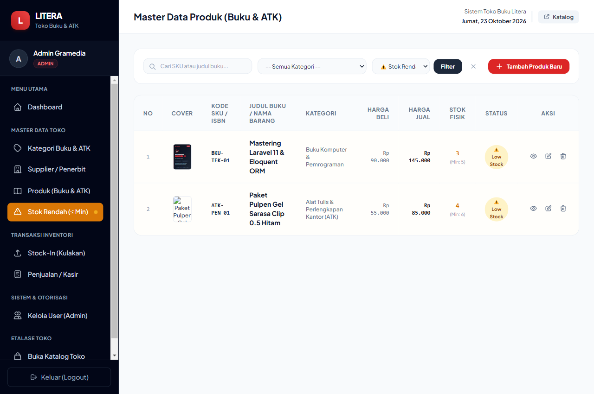

---

### 7. Transaksi: Riwayat Kulakan / Stock-In dari Penerbit
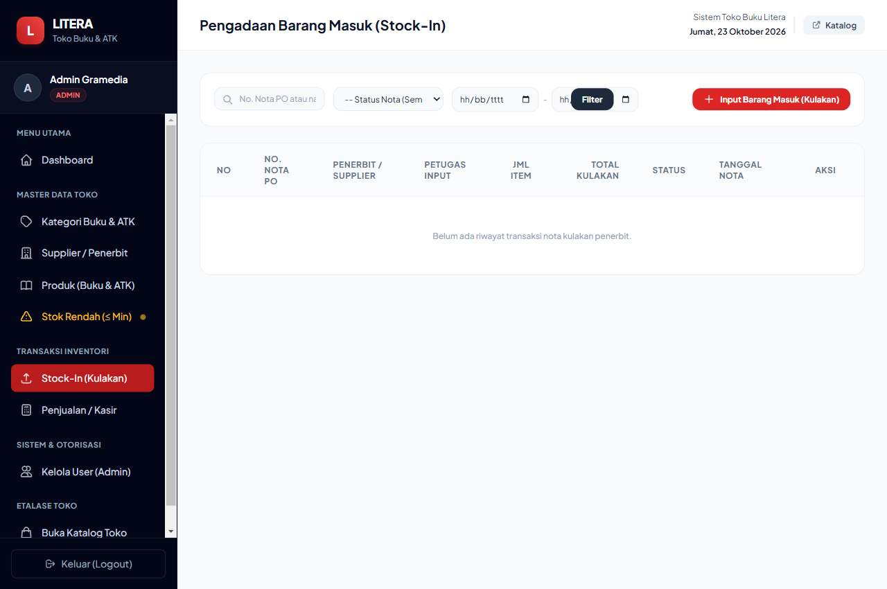

---

### 8. Transaksi: Form Input Barang Masuk Multi-Item
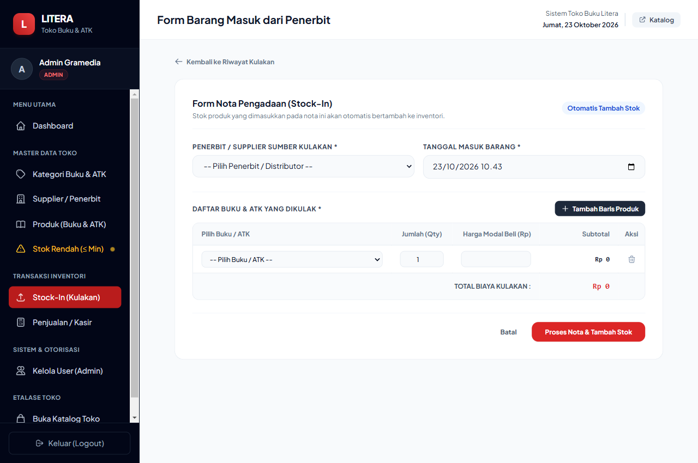

---

### 9. Transaksi: Riwayat Faktur Penjualan Kasir
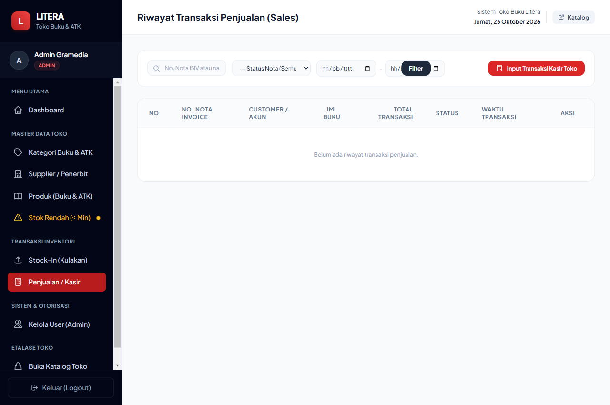

---

### 10. Transaksi: Form Kasir Toko Buku Multi-Item
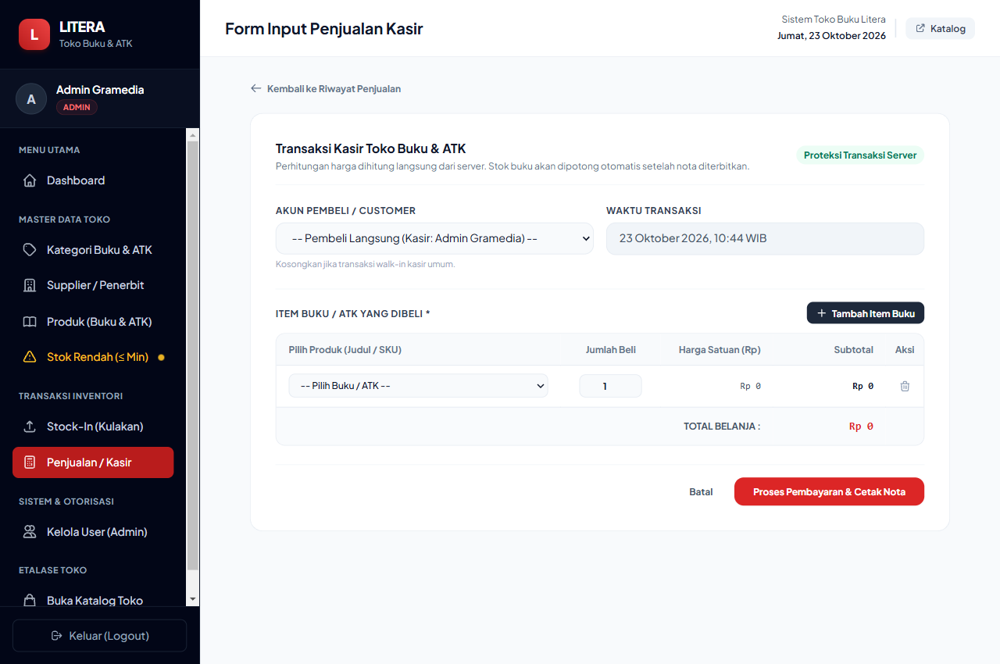

---

### 11. Otorisasi: Manajemen Akun Pengguna & Hak Akses (Role Admin)
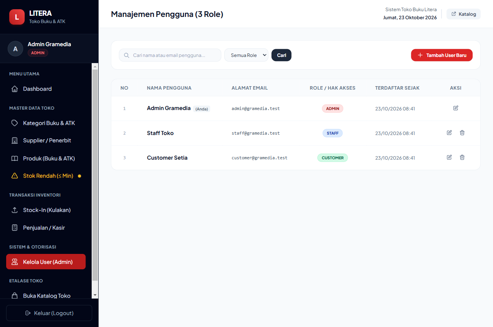

---

## 14. Panduan Wawancara Code Ownership

Berikut ringkasan jawaban teknis atas pertanyaan umum penguji seputar arsitektur kode:

1. **Mengapa Sale memiliki relasi `hasMany` ke SaleItem?**
   * *Jawaban:* Karena satu nota penjualan (*invoice*) dapat memuat banyak macam produk dengan kuantitas dan harga yang bervariasi (konsep normalisasi Header-Detail 1:N).
2. **Di mana letak kode pencegahan stok negatif?**
   * *Jawaban:* Di `SaleController.php` (baris 107–109) dan `CatalogController.php` (baris 178–180). Sistem mengecek `if ($product->stock < $qty)` dan melempar Exception yang otomatis memicu rollback.
3. **Mengapa nilai rupiah total penjualan dihitung di server?**
   * *Jawaban:* Mencegah manipulasi harga dari browser (*tampering*). Client hanya mengirimkan ID produk dan jumlah beli, sedangkan harga diambil langsung dari database server.
4. **Apa risiko jika pemotongan stok dilakukan di luar `DB::transaction`?**
   * *Jawaban:* Inkonsistensi data parsial. Jika stok sudah terpotong namun server mati atau database error sebelum nota tersimpan, stok barang fisik akan berkurang tanpa ada nomor nota penjualan.
5. **Bagaimana cara mencegah Staff mengakses fitur Admin via URL langsung?**
   * *Jawaban:* Menggunakan middleware `RoleMiddleware` di `routes/web.php` dan pemanggilan `authorizeAdmin()` di Controller. Request yang tidak berhak langsung dihentikan dengan status HTTP `403 Forbidden`.
6. **Apa yang terjadi bila 2 orang membeli buku terakhir pada milidetik yang sama?**
   * *Jawaban:* Menggunakan `Product::lockForUpdate()` (*pessimistic locking*). Transaksi kedua harus menunggu giliran hingga transaksi pertama selesai/commit, sehingga terhindar dari *race condition* dan *overselling*.
7. **Di mana letak validasi SKU unik?**
   * *Jawaban:* Di Controller: `'sku' => ['required', 'string', 'unique:products,sku']` dan di Database Migration: `$table->string('sku')->unique();` sebagai proteksi absolut tingkat mesin penyimpanan MySQL.
8. **Bagaimana cara mengubah aturan minimum stock?**
   * *Jawaban:* Edit nilai `minimum_stock` pada produk di `/products/{id}/edit`. Jika stok saat ini &le; `minimum_stock`, produk tersebut otomatis langsung masuk ke daftar **Low-Stock Alert** di Dashboard.
